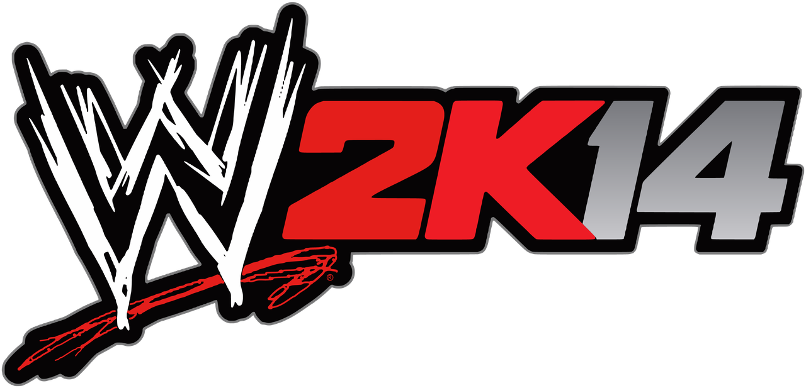

# WWE 2K14: Native PC Recompilation

A static recompilation of the **Xbox 360 version of WWE 2K14** into a native Windows x64 program, built with the
[ReXGlue SDK](https://github.com/rexglue/rexglue-sdk). WWE 2K14 never had a PC release (2K15 was the first WWE game
on PC), so this is a preservation project first and a creative toolkit second.

**No game files are included.** It runs only from your own copy of the Xbox 360 disc, dumped by you.

## What works

- The game natively: menus, matches start to finish, entrances with titantrons, the Royal Rumble, Hell in a Cell and
  the Elimination Chamber, 30 Years of WrestleMania, Create-a-Wrestler, saves, sound and controllers.
- 720p, 1440p or 4K; 60 or 120 fps, or your monitor's refresh rate; NVIDIA DLAA / DLSS on RTX cards.
- The game's own five languages (English, Deutsch, Français, Español, Italiano).
- A launcher in the style of the game's menus:
  - **Quick Match**: every match type from the game's PLAY menu, set up in the launcher, straight into the ring.
  - **Mods**: your own videos as titantrons and title reveals, and PNG pictures imported as real Create-a-Logo logos.
  - Settings (graphics card, display, frame rate, upscaling), a first-run wizard and a problem reporter.
- Extras: a free camera (CineCam), match replays and re-shoots.

How to play a build: [docs/release/README.md](docs/release/README.md). What changed: [docs/release/CHANGELOG.md](docs/release/CHANGELOG.md).

## Building from source

The build scripts are written for one Windows PC and still contain its paths; a portable build guide is planned.
The outline:

1. **Your game files.** Install the disc to an Xbox 360, copy the files to the PC (e.g. with FATXplorer), and put
   them in `game_data\extracted\` (it holds `default.xex`). `game_data\` is ignored by git.
2. **Tools:** Windows 10 / 11, standalone LLVM / Clang, CMake 3.25+, Ninja, Visual Studio 2022 (Windows SDK),
   Python 3.12 (`tools\env.ps1` sets them up).
3. **The ReXGlue SDK v0.10.0** from source in `thirdparty\rexglue-sdk-src`, with this project's patches
   (`patches\rexglue-sdk\`), built and installed with `tools\build_sdk.ps1`.
4. **Codegen and build:** `pwsh -File tools\build.ps1` recompiles the game's code (the generated C++ goes to
   `generated\`, ignored by git: it comes from your own copy) and builds `wwe2k14.exe` and `wwe2k14_launcher.exe`.

## Layout

| Folder | What it holds |
|---|---|
| `src\` | The app around the recompiled game: fixes, settings, the scenario launcher, CineCam, replays, mods |
| `src\launcher\` | The launcher (Dear ImGui, Direct3D 11) |
| `config\` | Codegen hints and fixes for the recompiler |
| `patches\` | Changes to the ReXGlue SDK (renderer, presenter, performance) |
| `tools\` | Build, test, analysis and release scripts |
| `db\ids\` | Character, arena and match type id tables |
| `assets\` | The launcher's logo |

## Credits

- [ReXGlue SDK](https://github.com/rexglue/rexglue-sdk), the recompiler and runtime this is built on, with portions
  from [Xenia](https://xenia.jp).
- [360tools](https://github.com/sp00nznet/360tools): stub templates and the recompilation workflow.
- [Dear ImGui](https://github.com/ocornut/imgui), [SDL](https://libsdl.org), [FFmpeg](https://ffmpeg.org),
  [stb_image](https://github.com/nothings/stb), [nlohmann/json](https://github.com/nlohmann/json),
  [NVIDIA DLSS / Streamline](https://developer.nvidia.com/rtx/streamline). Full list:
  [THIRD_PARTY_NOTICES.md](docs/release/THIRD_PARTY_NOTICES.md).
- Icon art: [SteamGridDB](https://www.steamgriddb.com) (fan-made).

## Licence

This project's own code is under the [BSD 3-Clause License](LICENSE). It does not cover the game (WWE 2K14 and the
code recompiled from it belong to their owners), the WWE 2K14 logo and icon art, or third-party libraries (their
own licences: [THIRD_PARTY_NOTICES.md](docs/release/THIRD_PARTY_NOTICES.md)).

## Disclaimer

A non-commercial fan preservation project: no donations, no paid builds. Not affiliated with or endorsed by WWE, 2K,
Take-Two Interactive, Yuke's or Visual Concepts. WWE 2K14 and all related names, logos and characters belong to their
owners. This repository contains no game code or data: you need your own copy of the game.

Developed with the assistance of [Claude](https://claude.com/), Anthropic's AI model.
